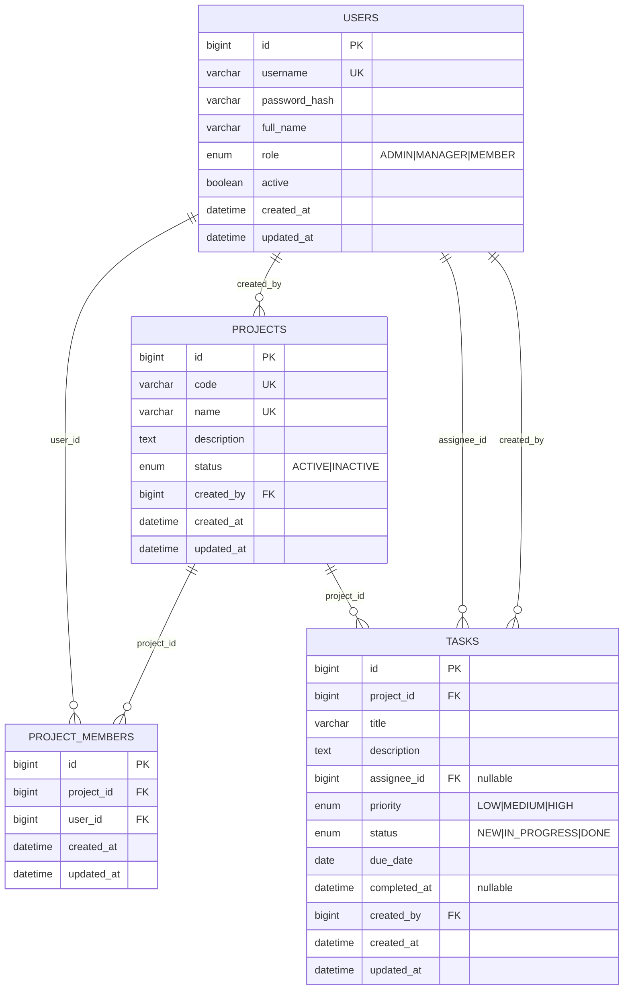

# BT01 – Thiết kế CSDL và khung API: Hệ thống quản lý công việc

> Phiên bản đề xuất 1.0. Dựa trên SRS BT01 (Java 21, Spring Boot 3, Spring Data JPA, MariaDB, Angular).
> Đây là bản đề xuất để mentor review, có thể điều chỉnh.

---

## 1. Sơ đồ quan hệ thực thể (ER)



**Quan hệ chính**
- 1 user (Manager) tạo nhiều project; 1 project có nhiều task.
- `project_members` là bảng trung gian N-N giữa `projects` và `users`.
- `tasks.assignee_id` có thể NULL (task chưa giao), nhưng không được chuyển DONE khi NULL (BR-03).

---

## 2. Script DDL (MariaDB)

Gợi ý dùng **Flyway**: `V1__init_schema.sql` và `V2__seed_data.sql` trong `src/main/resources/db/migration`.

```sql
-- V1__init_schema.sql
CREATE TABLE users (
    id            BIGINT UNSIGNED NOT NULL AUTO_INCREMENT,
    username      VARCHAR(50)  NOT NULL,
    password_hash VARCHAR(100) NOT NULL,              -- BCrypt (60 ký tự), chừa dư
    full_name     VARCHAR(100) NOT NULL,
    role          ENUM('ADMIN','MANAGER','MEMBER') NOT NULL,
    active        TINYINT(1)   NOT NULL DEFAULT 1,
    created_at    DATETIME     NOT NULL DEFAULT CURRENT_TIMESTAMP,
    updated_at    DATETIME     NOT NULL DEFAULT CURRENT_TIMESTAMP ON UPDATE CURRENT_TIMESTAMP,
    PRIMARY KEY (id),
    CONSTRAINT uk_users_username UNIQUE (username)
) ENGINE=InnoDB DEFAULT CHARSET=utf8mb4 COLLATE=utf8mb4_unicode_ci;

CREATE TABLE projects (
    id          BIGINT UNSIGNED NOT NULL AUTO_INCREMENT,
    code        VARCHAR(30)  NOT NULL,
    name        VARCHAR(150) NOT NULL,
    description TEXT NULL,
    status      ENUM('ACTIVE','INACTIVE') NOT NULL DEFAULT 'ACTIVE',
    created_by  BIGINT UNSIGNED NOT NULL,
    created_at  DATETIME NOT NULL DEFAULT CURRENT_TIMESTAMP,
    updated_at  DATETIME NOT NULL DEFAULT CURRENT_TIMESTAMP ON UPDATE CURRENT_TIMESTAMP,
    PRIMARY KEY (id),
    CONSTRAINT uk_projects_code UNIQUE (code),
    CONSTRAINT uk_projects_name UNIQUE (name),        -- collation *_ci => không phân biệt hoa/thường
    CONSTRAINT fk_projects_created_by FOREIGN KEY (created_by) REFERENCES users(id),
    INDEX idx_projects_status (status),
    INDEX idx_projects_created_by (created_by)
) ENGINE=InnoDB DEFAULT CHARSET=utf8mb4 COLLATE=utf8mb4_unicode_ci;

CREATE TABLE project_members (
    id         BIGINT UNSIGNED NOT NULL AUTO_INCREMENT,
    project_id BIGINT UNSIGNED NOT NULL,
    user_id    BIGINT UNSIGNED NOT NULL,
    created_at DATETIME NOT NULL DEFAULT CURRENT_TIMESTAMP,
    updated_at DATETIME NOT NULL DEFAULT CURRENT_TIMESTAMP ON UPDATE CURRENT_TIMESTAMP,
    PRIMARY KEY (id),
    CONSTRAINT uk_project_members UNIQUE (project_id, user_id),   -- 1 user chỉ 1 lần/ dự án
    CONSTRAINT fk_pm_project FOREIGN KEY (project_id) REFERENCES projects(id),
    CONSTRAINT fk_pm_user    FOREIGN KEY (user_id)    REFERENCES users(id),
    INDEX idx_pm_user (user_id)
) ENGINE=InnoDB DEFAULT CHARSET=utf8mb4 COLLATE=utf8mb4_unicode_ci;

CREATE TABLE tasks (
    id           BIGINT UNSIGNED NOT NULL AUTO_INCREMENT,
    project_id   BIGINT UNSIGNED NOT NULL,
    title        VARCHAR(200) NOT NULL,
    description  TEXT NULL,
    assignee_id  BIGINT UNSIGNED NULL,
    priority     ENUM('LOW','MEDIUM','HIGH') NOT NULL DEFAULT 'MEDIUM',
    status       ENUM('NEW','IN_PROGRESS','DONE') NOT NULL DEFAULT 'NEW',
    due_date     DATE NULL,
    completed_at DATETIME NULL,
    created_by   BIGINT UNSIGNED NOT NULL,
    created_at   DATETIME NOT NULL DEFAULT CURRENT_TIMESTAMP,
    updated_at   DATETIME NOT NULL DEFAULT CURRENT_TIMESTAMP ON UPDATE CURRENT_TIMESTAMP,
    PRIMARY KEY (id),
    CONSTRAINT fk_tasks_project  FOREIGN KEY (project_id)  REFERENCES projects(id),
    CONSTRAINT fk_tasks_assignee FOREIGN KEY (assignee_id) REFERENCES users(id),
    CONSTRAINT fk_tasks_creator  FOREIGN KEY (created_by)  REFERENCES users(id),
    INDEX idx_tasks_project_status (project_id, status),   -- lọc theo dự án + trạng thái, dashboard
    INDEX idx_tasks_assignee_status (assignee_id, status), -- "việc của tôi"
    INDEX idx_tasks_due_date (due_date)
) ENGINE=InnoDB DEFAULT CHARSET=utf8mb4 COLLATE=utf8mb4_unicode_ci;
```

### Lý do thiết kế
| Quyết định | Lý do |
| --- | --- |
| FK không dùng `ON DELETE CASCADE` | Phù hợp BR-05: không xóa cứng dự án có task; dự án chuyển `INACTIVE` |
| `UNIQUE (project_id, user_id)` | Chặn thêm trùng thành viên, ghi nhận lỗi 409 |
| Collation `utf8mb4_unicode_ci` | Hỗ trợ tiếng Việt; tên dự án không trùng không phân biệt hoa/thường |
| Index `(project_id, status)` | Phục vụ UC06 lọc và thống kê dashboard |
| `tasks.created_by` (bổ sung) | Truy vết người tạo, hữu ích khi review/log |
| `completed_at` | Ghi thời điểm hoàn thành (BR-04); đặt NULL khi mở lại |
| Không dùng CHECK `due_date >= created_at` | `created_at` tự sinh, kiểm tra ở Service (BR-02) cho thông báo lỗi rõ ràng |

### Dữ liệu mẫu (gợi ý cho `V2__seed_data.sql`)
| username | role | Ghi chú |
| --- | --- | --- |
| admin | ADMIN | 1 tài khoản |
| manager1 | MANAGER | tạo dự án trong demo |
| member1, member2, member3 | MEMBER | member3 không thuộc dự án nào (dùng cho TC-02) |

Mật khẩu seed phải là chuỗi **BCrypt hash** (không ghi plaintext trong SQL). Có thể sinh hash bằng `BCryptPasswordEncoder` rồi dán vào script, và ghi mật khẩu demo vào README.
Nên seed thêm 1–2 dự án, vài chục task với đủ 3 trạng thái để TC-05 (lọc và phân trang) có dữ liệu kiểm tra.

---

## 3. Quy tắc nghiệp vụ → nơi kiểm tra

| BR | Nơi xử lý | Lỗi trả về |
| --- | --- | --- |
| BR-01 Giao task cho người ngoài dự án | `TaskService.create/update`: kiểm tra `project_members` | 422 `ASSIGNEE_NOT_IN_PROJECT` |
| BR-02 Hạn không trước ngày tạo | `TaskService`: `dueDate >= today` (tạo) / `>= createdAt.toLocalDate()` (sửa) | 400 `INVALID_DUE_DATE` |
| BR-03 DONE phải có assignee | `TaskService.changeStatus` | 422 `ASSIGNEE_REQUIRED_FOR_DONE` |
| BR-04 Mở lại task DONE chỉ Manager; ghi `completed_at` | `changeStatus`: DONE → set `completed_at = now`; mở lại → set NULL | 403 `ONLY_MANAGER_CAN_REOPEN` |
| BR-05 Không xóa cứng dự án có task | Không cung cấp API DELETE; dùng `status = INACTIVE` | – |

**Luồng chuyển trạng thái**
```
NEW ──► IN_PROGRESS ──► DONE
                          │ (chỉ MANAGER/ADMIN)
                          ▼
                     IN_PROGRESS   (mở lại)
```
Chặn các bước nhảy cóc (ví dụ NEW → DONE): trả 422 `INVALID_STATUS_TRANSITION`.

**Quy tắc đề xuất bổ sung (cần xác nhận với mentor)**
- Không cho tạo task trong dự án `INACTIVE`.
- Không cho bỏ thành viên đang có task chưa DONE (hoặc yêu cầu gỡ assignee trước).
- Chỉ user `active = true` mới đăng nhập được và được giao task.

---

## 4. Ma trận phân quyền

| Chức năng | ADMIN | MANAGER | MEMBER |
| --- | :---: | :---: | :---: |
| Đăng nhập | ✔ | ✔ | ✔ |
| Quản lý tài khoản (nếu làm) | ✔ | ✖ | ✖ |
| Xem danh sách dự án | ✔ (tất cả) | ✔ (tất cả hoặc do mình tạo) | ✔ (dự án mình tham gia) |
| Tạo/sửa dự án | ✔ | ✔ | ✖ |
| Thêm/bỏ thành viên | ✔ | ✔ | ✖ |
| Tạo/sửa toàn bộ task | ✔ | ✔ | ✖ |
| Xem task | ✔ (tất cả) | ✔ (dự án của mình) | ✔ (task được giao / dự án tham gia) |
| Cập nhật trạng thái | ✔ | ✔ | ✔ (chỉ task được giao) |
| Mở lại task DONE | ✔ | ✔ | ✖ |
| Dashboard | ✔ | ✔ | ✔ (số liệu của mình) |

Triển khai: `@PreAuthorize("hasAnyRole('ADMIN','MANAGER')")` ở controller cho phân quyền thô; kiểm tra quyền sở hữu (member chỉ sửa task của mình) ở Service.

---

## 5. Quy ước chung của API

- Base path: `/api`, dữ liệu JSON (UTF-8), ngày `yyyy-MM-dd`, thời gian ISO-8601.
- Xác thực: header `Authorization: Bearer <JWT>` (trừ `/api/auth/login`, Swagger).
- Phân trang: `?page=0&size=10&sort=createdAt,desc`

**Response danh sách**
```json
{
  "content": [ { } ],
  "page": 0,
  "size": 10,
  "totalElements": 42,
  "totalPages": 5
}
```

**Response lỗi thống nhất** `{code, message, details}`
```json
{
  "code": "VALIDATION_ERROR",
  "message": "Dữ liệu đầu vào không hợp lệ",
  "details": [
    { "field": "title", "message": "Tiêu đề không được để trống" }
  ]
}
```

**Bảng mã lỗi gợi ý**
| HTTP | code | Khi nào |
| --- | --- | --- |
| 400 | `VALIDATION_ERROR`, `INVALID_DUE_DATE` | Dữ liệu sai định dạng/ràng buộc |
| 401 | `UNAUTHORIZED`, `BAD_CREDENTIALS` | Chưa đăng nhập, token hết hạn, sai tài khoản/mật khẩu |
| 403 | `FORBIDDEN`, `ONLY_MANAGER_CAN_REOPEN` | Không đủ quyền |
| 404 | `NOT_FOUND` | Không thấy tài nguyên |
| 409 | `DUPLICATE_PROJECT_NAME`, `MEMBER_ALREADY_EXISTS` | Trùng dữ liệu unique |
| 422 | `ASSIGNEE_NOT_IN_PROJECT`, `ASSIGNEE_REQUIRED_FOR_DONE`, `INVALID_STATUS_TRANSITION` | Vi phạm quy tắc nghiệp vụ |
| 500 | `INTERNAL_ERROR` | Lỗi không lường trước (không lộ stack trace) |

Lưu ý: thông báo đăng nhập sai chỉ nói chung "Sai tài khoản hoặc mật khẩu", không tiết lộ tài khoản có tồn tại hay không.

---

## 6. Chi tiết REST API

### 6.1 Xác thực

#### `POST /api/auth/login` (công khai)
Request
```json
{ "username": "manager1", "password": "******" }
```
Response `200`
```json
{
  "accessToken": "eyJhbGciOi...",
  "tokenType": "Bearer",
  "expiresIn": 3600,
  "user": { "id": 2, "username": "manager1", "fullName": "Nguyễn Văn A", "role": "MANAGER" }
}
```
Lỗi: `401 BAD_CREDENTIALS`, `400 VALIDATION_ERROR`.

> Bổ sung nên có (hỗ trợ Angular): `GET /api/auth/me` trả thông tin user hiện tại.

---

### 6.2 Dự án

#### `GET /api/projects` (mọi vai trò, có lọc theo quyền)
Query: `keyword`, `status` (ACTIVE|INACTIVE), `page`, `size`, `sort`.
Response `200`: danh sách phân trang
```json
{
  "content": [
    { "id": 1, "code": "PRJ-001", "name": "Website nội bộ", "status": "ACTIVE",
      "createdBy": { "id": 2, "fullName": "Nguyễn Văn A" }, "memberCount": 3, "taskCount": 12 }
  ],
  "page": 0, "size": 10, "totalElements": 1, "totalPages": 1
}
```

#### `POST /api/projects` (ADMIN, MANAGER)
Request
```json
{ "code": "PRJ-001", "name": "Website nội bộ", "description": "Cổng thông tin nội bộ" }
```
Validate: `code` bắt buộc, ≤ 30 ký tự, duy nhất; `name` bắt buộc, ≤ 150 ký tự, duy nhất.
Response `201` + header `Location: /api/projects/{id}`; lỗi `409 DUPLICATE_PROJECT_NAME`.

#### `PUT /api/projects/{id}` (ADMIN, MANAGER)
Request
```json
{ "name": "Website nội bộ v2", "description": "...", "status": "ACTIVE" }
```
Dùng `status = INACTIVE` để ngừng dự án (thay cho xóa). `code` không cho đổi.
Response `200`; lỗi `404`, `409`.

#### Bổ sung đề xuất: `GET /api/projects/{id}` (chi tiết kèm danh sách thành viên)

---

### 6.3 Thành viên dự án

#### `POST /api/projects/{id}/members` (ADMIN, MANAGER)
Request
```json
{ "userId": 5 }
```
Response `201`
```json
{ "projectId": 1, "userId": 5, "fullName": "Trần Thị B", "role": "MEMBER" }
```
Lỗi: `404` (project/user không có), `409 MEMBER_ALREADY_EXISTS`, `422` nếu user không active.

#### Bổ sung đề xuất
| Method | Endpoint | Mục đích |
| --- | --- | --- |
| GET | `/api/projects/{id}/members` | Danh sách thành viên (dùng cho dropdown người phụ trách) |
| DELETE | `/api/projects/{id}/members/{userId}` | Bỏ thành viên (UC03 có "bỏ") – `204`; `422` nếu còn task chưa DONE |

---

### 6.4 Công việc

#### `GET /api/tasks`
Query:
| Tham số | Ý nghĩa |
| --- | --- |
| `projectId` | Lọc theo dự án |
| `status` | NEW / IN_PROGRESS / DONE |
| `assigneeId` | Lọc theo người phụ trách |
| `priority` (tùy chọn) | LOW / MEDIUM / HIGH |
| `keyword` (tùy chọn) | Tìm theo tiêu đề |
| `page`, `size`, `sort` | Mặc định `page=0&size=10&sort=createdAt,desc` |

Response `200`
```json
{
  "content": [
    { "id": 10, "projectId": 1, "projectName": "Website nội bộ", "title": "Thiết kế màn hình đăng nhập",
      "priority": "HIGH", "status": "IN_PROGRESS", "dueDate": "2026-12-05",
      "assignee": { "id": 5, "fullName": "Trần Thị B" }, "completedAt": null }
  ],
  "page": 0, "size": 10, "totalElements": 1, "totalPages": 1
}
```
Member chỉ thấy task thuộc phạm vi được phép (ví dụ task của mình/dự án tham gia).

#### `POST /api/tasks` (ADMIN, MANAGER)
Request
```json
{
  "projectId": 1,
  "title": "Thiết kế màn hình đăng nhập",
  "description": "Theo mockup Figma",
  "priority": "HIGH",
  "dueDate": "2026-12-05",
  "assigneeId": 5
}
```
Validate: `projectId`, `title` (≤ 200) bắt buộc; `priority` thuộc enum; `dueDate` ≥ hôm nay (BR-02); `assigneeId` (nếu có) phải thuộc dự án (BR-01).
Response `201` (status ban đầu luôn `NEW`); lỗi `400`, `404`, `422 ASSIGNEE_NOT_IN_PROJECT`.

#### `GET /api/tasks/{id}`
Response `200`: chi tiết task đầy đủ (gồm `createdBy`, `createdAt`, `updatedAt`, `completedAt`). Lỗi `403/404`.

#### `PUT /api/tasks/{id}` (ADMIN, MANAGER)
Request: như `POST` nhưng **không** gồm `projectId` và `status` (đổi trạng thái qua PATCH).
Response `200`; lỗi `400`, `404`, `422`.

> Lưu ý TC-03: Member chỉ được thao tác trạng thái task của mình; nếu cho Member sửa nội dung thì phải kiểm tra `assignee_id = currentUser`, người khác nhận `403`.

#### `PATCH /api/tasks/{id}/status` (ADMIN, MANAGER, MEMBER là assignee)
Request
```json
{ "status": "DONE" }
```
Response `200`
```json
{ "id": 10, "status": "DONE", "completedAt": "2026-11-27T10:15:30" }
```
Lỗi: `403` (không phải assignee/manager, hoặc Member mở lại task DONE), `422 ASSIGNEE_REQUIRED_FOR_DONE`, `422 INVALID_STATUS_TRANSITION`.

---

### 6.5 Dashboard

#### `GET /api/dashboard/tasks`
Query (tùy chọn): `projectId`, `assigneeId`.
Response `200`
```json
{
  "total": 20,
  "byStatus": { "NEW": 8, "IN_PROGRESS": 7, "DONE": 5 }
}
```
Luôn trả đủ 3 khóa trạng thái (giá trị 0 nếu không có) để FE vẽ biểu đồ không phải xử lý thiếu key. Có thể thêm `overdue` (số task quá hạn chưa DONE) nếu còn thời gian.

---

### 6.6 Tài khoản (ngoài danh sách tối thiểu, cần để hỗ trợ chọn thành viên)
| Method | Endpoint | Quyền | Mục đích |
| --- | --- | --- | --- |
| GET | `/api/users` | ADMIN, MANAGER | Danh sách user (lọc `role`, `active`, `keyword`) để chọn thêm vào dự án |
| POST/PUT | `/api/users` | ADMIN | Tạo/sửa/khóa tài khoản (chỉ làm nếu còn thời gian, có thể dùng seed cho demo) |

---

## 7. Tổng hợp endpoint

| Method | Endpoint | Quyền | Mức ưu tiên |
| --- | --- | --- | --- |
| POST | /api/auth/login | Công khai | Bắt buộc |
| GET | /api/auth/me | Đăng nhập | Nên có |
| GET | /api/projects | Đăng nhập | Bắt buộc |
| POST | /api/projects | ADMIN, MANAGER | Bắt buộc |
| GET | /api/projects/{id} | Đăng nhập | Nên có |
| PUT | /api/projects/{id} | ADMIN, MANAGER | Bắt buộc |
| GET | /api/projects/{id}/members | Đăng nhập | Nên có |
| POST | /api/projects/{id}/members | ADMIN, MANAGER | Bắt buộc |
| DELETE | /api/projects/{id}/members/{userId} | ADMIN, MANAGER | Nên có (UC03) |
| GET | /api/tasks | Đăng nhập | Bắt buộc |
| POST | /api/tasks | ADMIN, MANAGER | Bắt buộc |
| GET | /api/tasks/{id} | Đăng nhập | Bắt buộc |
| PUT | /api/tasks/{id} | ADMIN, MANAGER | Bắt buộc |
| PATCH | /api/tasks/{id}/status | ADMIN, MANAGER, assignee | Bắt buộc |
| GET | /api/dashboard/tasks | Đăng nhập | Bắt buộc |
| GET | /api/users | ADMIN, MANAGER | Nên có |

---

## 8. Khung dự án gợi ý (Backend)

```
src/main/java/com/example/taskmgmt
├── config/        SecurityConfig, OpenApiConfig, JwtProperties
├── security/      JwtService, JwtAuthFilter, CustomUserDetailsService
├── controller/    AuthController, ProjectController, TaskController, DashboardController, UserController
├── service/       AuthService, ProjectService, TaskService, DashboardService
├── repository/    UserRepository, ProjectRepository, ProjectMemberRepository, TaskRepository
├── entity/        User, Project, ProjectMember, Task, enums (Role, ProjectStatus, TaskStatus, Priority)
├── dto/           request/ và response/ (tách biệt Entity; có thể dùng record + MapStruct)
├── exception/     BusinessException, GlobalExceptionHandler (@RestControllerAdvice), ErrorResponse
└── specification/ TaskSpecification (lọc động theo projectId, status, assigneeId)
src/main/resources/db/migration/  V1__init_schema.sql, V2__seed_data.sql
src/test/java/...                 TaskServiceTest, ProjectServiceTest, TaskControllerIT ...
```

**Gợi ý kỹ thuật**
- Lọc động: `JpaSpecificationExecutor<Task>` + `Pageable`.
- Dashboard: query `SELECT status, COUNT(*) FROM tasks WHERE ... GROUP BY status` (JPQL `GROUP BY`).
- Ngăn lỗi N+1: dùng `@EntityGraph` hoặc `JOIN FETCH` khi trả danh sách task kèm assignee/project.
- Bảo mật: `BCryptPasswordEncoder`, JWT stateless, CORS cho `http://localhost:4200`, không log password/token.
- Swagger: `springdoc-openapi-starter-webmvc-ui`, khai báo `bearerAuth` để thử API có token.

## 9. Gợi ý 5+ test bắt buộc (khớp UAT)

| Test | Quy tắc | UAT |
| --- | --- | --- |
| Tạo dự án trùng tên → 409 | UC02 | – |
| Thêm 2 thành viên vào dự án thành công | UC03 | TC-01 |
| Giao task cho người ngoài dự án → 422 | BR-01 | TC-02 |
| Member sửa trạng thái task của người khác → 403 | Phân quyền | TC-03 |
| Chuyển DONE khi chưa có assignee → 422 | BR-03 | TC-04 |
| Mở lại task DONE bằng Member → 403, bằng Manager → thành công và xóa `completed_at` | BR-04 | – |
| Lọc theo status + phân trang trả đúng `totalElements` | UC06 | TC-05 |

## 10. Thứ tự làm đề xuất cho demo lần 1 (30/11/2026)

1. Migration + seed + entity/repository.
2. Đăng nhập JWT + phân quyền (login, `/me`).
3. API dự án + thành viên.
4. API task + `PATCH status` (kèm BR-01, 02, 03).
5. Dashboard.
6. Angular: Login → Dự án → Thành viên → Task → Cập nhật trạng thái → Dashboard (đúng luồng demo mục 10 SRS).
7. Test, Swagger, README. Các chức năng phụ (xóa thành viên, quản lý user) để vòng sau.
